# OT Network Segmentation Lab (Cisco Packet Tracer)

A small industrial network built to practise how plants protect operational technology (OT): Purdue-model zones, security rules between them, a protected legacy Windows XP zone, and packet monitoring.

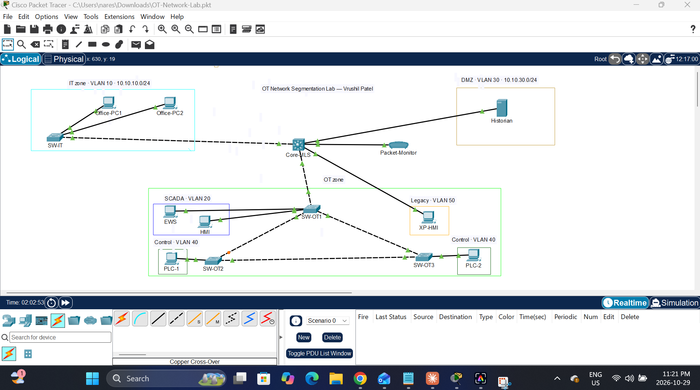

## What it shows

- **Segmentation:** IT, DMZ, SCADA, Control and Legacy zones, each on its own VLAN and subnet.
- **Least-privilege rules:** ACLs on the core switch allow only the conversations each zone needs.
- **Legacy protection:** a Windows XP machine (stand-in) that can't be patched is isolated. It can reach only the PLCs and the historian, and nothing in IT can reach it.
- **Monitoring:** all traffic in and out of the legacy zone is mirrored (SPAN) to a packet monitor.
- **Redundancy:** three OT switches in a ring with Rapid Spanning Tree.

## Zones

| Zone | Purdue level | VLAN | Subnet | Gateway (on Core-MLS) |
|---|---|---|---|---|
| IT office | 4 | 10 IT_OFFICE | 10.10.10.0/24 | 10.10.10.1 |
| DMZ (historian) | 3.5 | 30 OT_DMZ | 10.10.30.0/24 | 10.10.30.1 |
| SCADA (HMI, engineering workstation) | 2 | 20 OT_SCADA | 10.10.20.0/24 | 10.10.20.1 |
| Legacy (Windows XP HMI) | 2 | 50 OT_LEGACY | 10.10.50.0/24 | 10.10.50.1 |
| Control (PLCs) | 1 | 40 OT_CONTROL | 10.10.40.0/24 | 10.10.40.1 |

## Device addressing

Every device uses a static IP with subnet mask 255.255.255.0 (/24). OT devices use fixed addresses so nothing depends on a DHCP server.

| Device | Role | Zone | VLAN | IP address | Default gateway | Connected to |
|---|---|---|---|---|---|---|
| Office-PC1 | Office workstation | IT office | 10 | 10.10.10.11 | 10.10.10.1 | SW-IT Fa0/1 |
| Office-PC2 | Office workstation | IT office | 10 | 10.10.10.12 | 10.10.10.1 | SW-IT Fa0/2 |
| Historian | Stores plant data, serves a web page | DMZ | 30 | 10.10.30.10 | 10.10.30.1 | Core-MLS Fa0/10 |
| HMI | Operator screen | SCADA | 20 | 10.10.20.11 | 10.10.20.1 | SW-OT1 Fa0/1 |
| EWS | Engineering workstation (programs PLCs) | SCADA | 20 | 10.10.20.12 | 10.10.20.1 | SW-OT1 Fa0/2 |
| XP-HMI | Legacy Windows XP operator station | Legacy | 50 | 10.10.50.11 | 10.10.50.1 | Core-MLS Fa0/11 |
| PLC-1 | Controller | Control | 40 | 10.10.40.11 | 10.10.40.1 | SW-OT2 Fa0/1 |
| PLC-2 | Controller | Control | 40 | 10.10.40.12 | 10.10.40.1 | SW-OT3 Fa0/1 |
| Packet-Monitor | Sniffer, listens only | Monitoring | none | none | none | Core-MLS Fa0/12 (SPAN destination) |

### Core switch gateways

| Interface | IP address | Zone it serves | ACL applied inbound |
|---|---|---|---|
| Vlan10 | 10.10.10.1 | IT office | IT_IN |
| Vlan20 | 10.10.20.1 | SCADA | SCADA_IN |
| Vlan30 | 10.10.30.1 | DMZ | DMZ_IN |
| Vlan40 | 10.10.40.1 | Control | CONTROL_IN |
| Vlan50 | 10.10.50.1 | Legacy | LEGACY_IN |

### Switch links

| Link | Type | VLANs carried |
|---|---|---|
| Core-MLS Fa0/1 to SW-IT Fa0/24 | Trunk | 10 |
| Core-MLS Fa0/2 to SW-OT1 Fa0/24 | Trunk | 20, 40 |
| SW-OT1 Gi0/1 to SW-OT2 Gi0/1 | Trunk (ring) | 20, 40 |
| SW-OT1 Gi0/2 to SW-OT3 Gi0/1 | Trunk (ring) | 20, 40 |
| SW-OT2 Gi0/2 to SW-OT3 Gi0/2 | Trunk (ring, standby) | 20, 40 |

## Rules between zones

| Zone | Allowed | Blocked |
|---|---|---|
| IT office (10.10.10.0/24) | Open the historian's web page (10.10.30.10, ports 80 and 443) | Anything into OT or the legacy zone, and pinging the historian |
| SCADA (10.10.20.0/24) | Talk to the PLCs and the historian | Everything else |
| Control (10.10.40.0/24) | Talk to SCADA and the legacy HMI | Everything else |
| DMZ (10.10.30.0/24) | Reply when contacted | Starting any connection |
| Legacy (10.10.50.0/24) | Talk to the PLCs, send data to the historian's web page | Everything else, including IT and the internet |

## Before and after

| Before the rules: Office-PC1 (10.10.10.11) reaches PLC-1 (10.10.40.11) | After the rules: blocked |
|---|---|
| 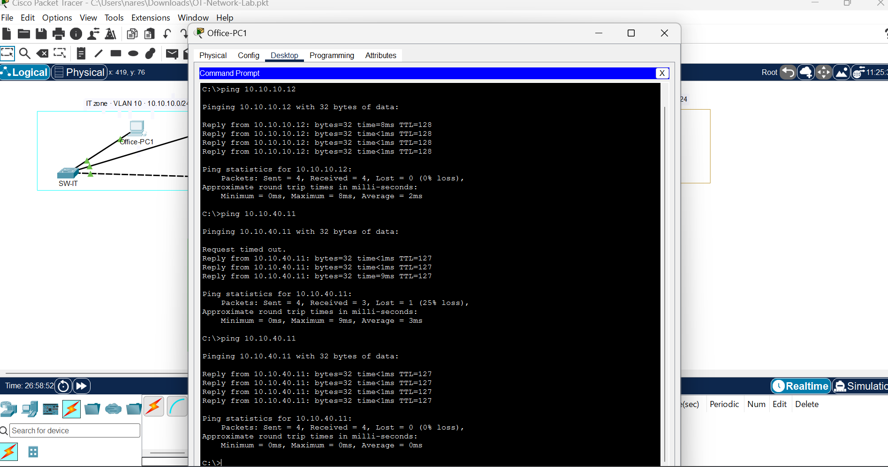 | 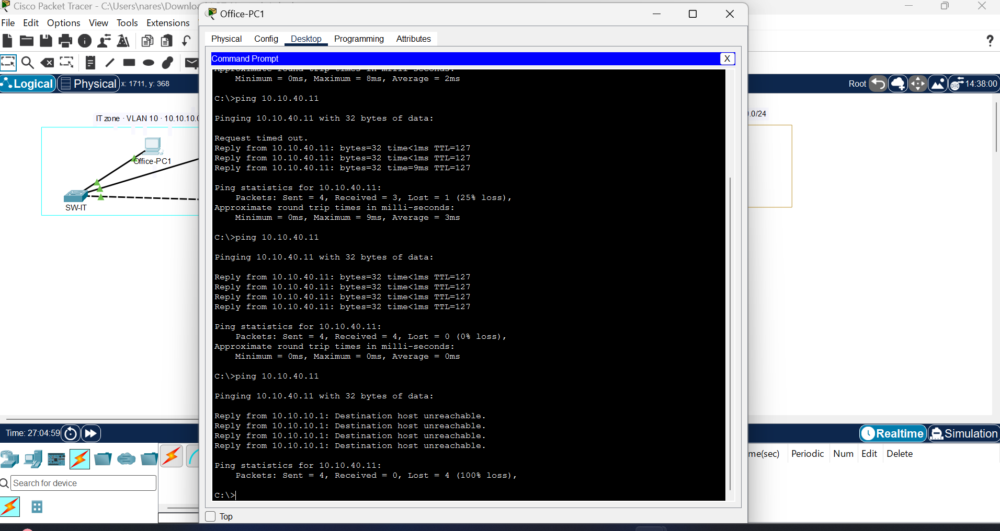 |

## Test results

| # | From | To | Command | Expected | Result | Proof |
|---|---|---|---|---|---|---|
| 1 | Office-PC1 (10.10.10.11) | Historian (10.10.30.10) | Web browser: `http://10.10.30.10` | Works | Pass | [screenshot](screenshots/09-historian-web.png) |
| 2 | Office-PC1 (10.10.10.11) | Historian (10.10.30.10) | `ping 10.10.30.10` | Blocked | Pass | [screenshot](screenshots/10-office-blocked.png) |
| 3 | Office-PC1 (10.10.10.11) | HMI (10.10.20.11) | `ping 10.10.20.11` | Blocked | Pass | [screenshot](screenshots/10-office-blocked.png) |
| 4 | Office-PC1 (10.10.10.11) | PLC-1 (10.10.40.11) | `ping 10.10.40.11` | Blocked | Pass | [screenshot](screenshots/10-office-blocked.png) |
| 5 | Office-PC1 (10.10.10.11) | XP-HMI (10.10.50.11) | `ping 10.10.50.11` | Blocked | Pass | [screenshot](screenshots/10-office-blocked.png) |
| 6 | EWS (10.10.20.12) | PLC-1 (10.10.40.11) | `ping 10.10.40.11` | Works | Pass | [screenshot](screenshots/11-ews-to-plc.png) |
| 7 | HMI (10.10.20.11) | Historian (10.10.30.10) | `ping 10.10.30.10` | Works | Pass | [screenshot](screenshots/12-hmi-to-historian.png) |
| 8 | Historian (10.10.30.10) | HMI (10.10.20.11) | `ping 10.10.20.11` | Blocked | Pass | [screenshot](screenshots/13-dmz-blocked.png) |
| 9 | PLC-1 (10.10.40.11) | PLC-2 (10.10.40.12) | `ping 10.10.40.12` | Works (same VLAN) | Pass | [screenshot](screenshots/14-plc-to-plc.png) |
| 10 | XP-HMI (10.10.50.11) | PLC-1 (10.10.40.11) | `ping 10.10.40.11` | Works | Pass | [screenshot](screenshots/15-xp-pings.png) |
| 11 | XP-HMI (10.10.50.11) | Office-PC1 (10.10.10.11) | `ping 10.10.10.11` | Blocked | Pass | [screenshot](screenshots/15-xp-pings.png) |
| 12 | XP-HMI (10.10.50.11) | Historian (10.10.30.10) | Web browser: `http://10.10.30.10` | Works | Pass | [screenshot](screenshots/16-xp-historian-web.png) |

Blocked pings show `Destination host unreachable` from the sender's own gateway (for example 10.10.10.1), which is the core switch refusing to forward the packet.

## Evidence

### Packet blocked at the core switch (Simulation mode)

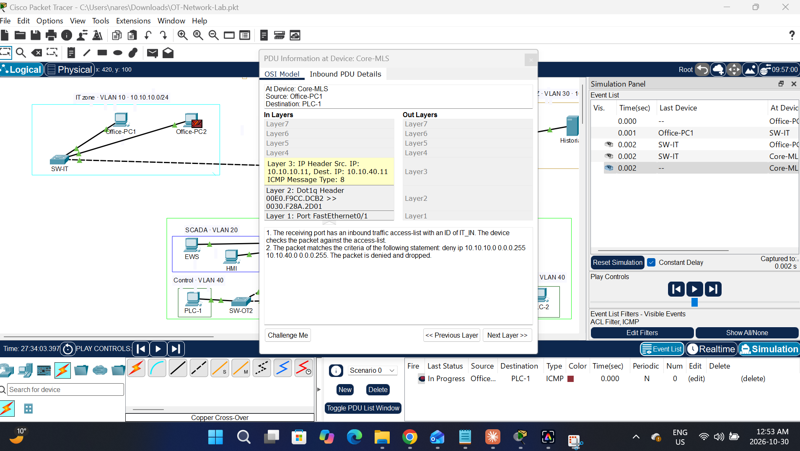

The core switch checks the IT_IN access list, matches the rule blocking 10.10.10.0/24 from reaching 10.10.40.0/24, and drops the packet before it ever reaches the OT zone.

### Which rules matched during testing

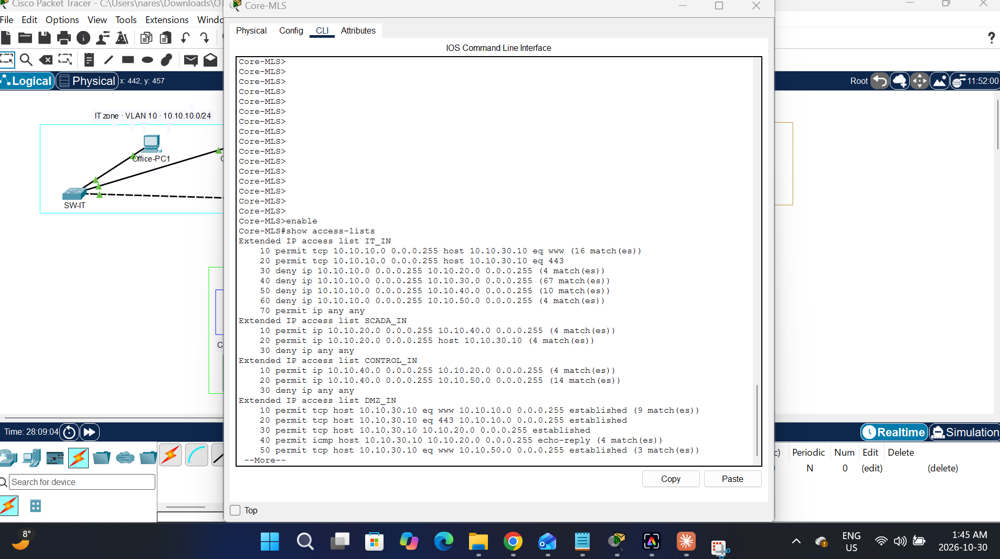

The match counts show each rule doing its job during the tests above.

### Legacy zone traffic copied to the monitor

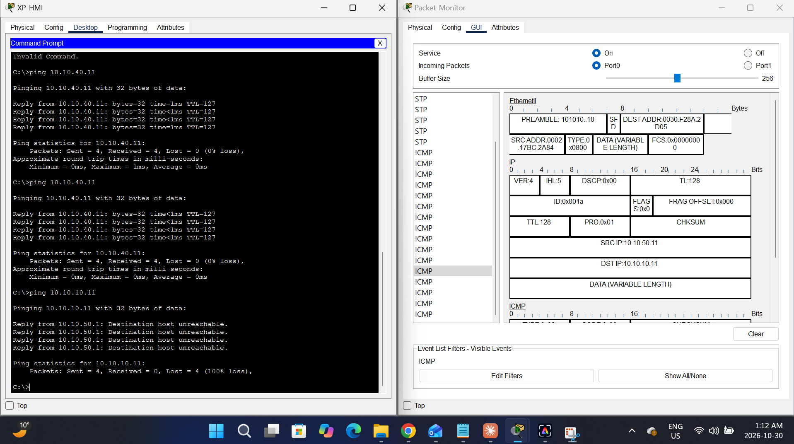

The monitor records XP-HMI (10.10.50.11) trying to reach Office-PC1 (10.10.10.11), even though the core switch blocked it. Monitoring shows every attempt, including blocked ones.

### Redundant ring: one link on standby

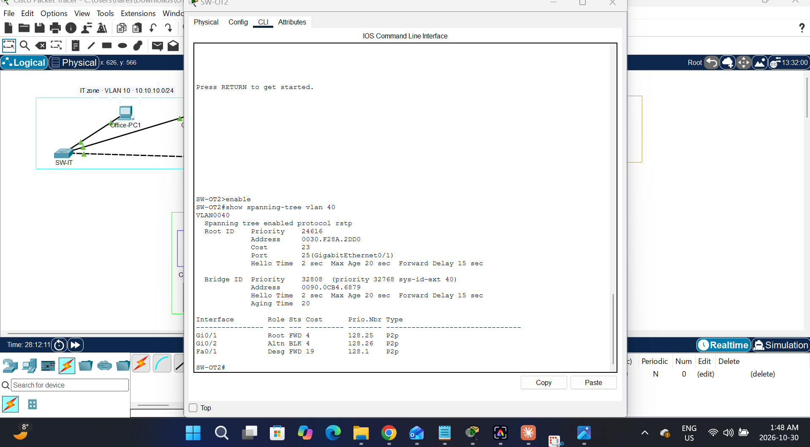

SW-OT2 keeps its link to SW-OT3 on standby (Altn BLK) to prevent a loop. If another ring link fails, it starts forwarding, so the PLCs stay reachable. The root priority of 24616 shows the core switch controls the tree.

## How I built it

<details>
<summary>Click to see the build steps</summary>

1. **Planned the zones and placed the devices**

   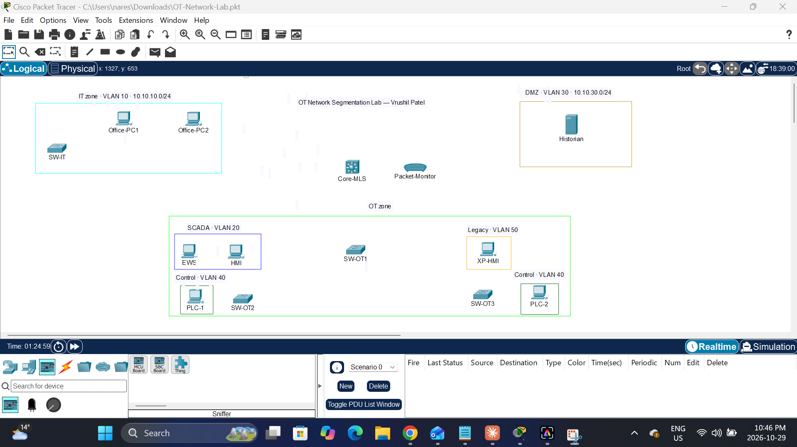

2. **Gave every device a static IP** (see the device addressing table above)

   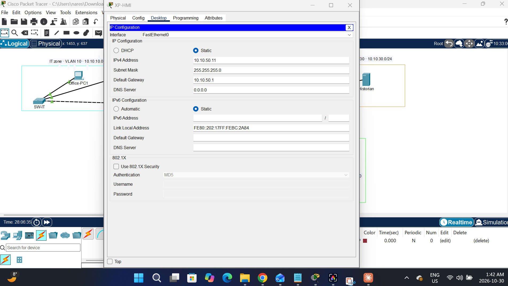

3. **Created VLANs and put each port in its zone**

   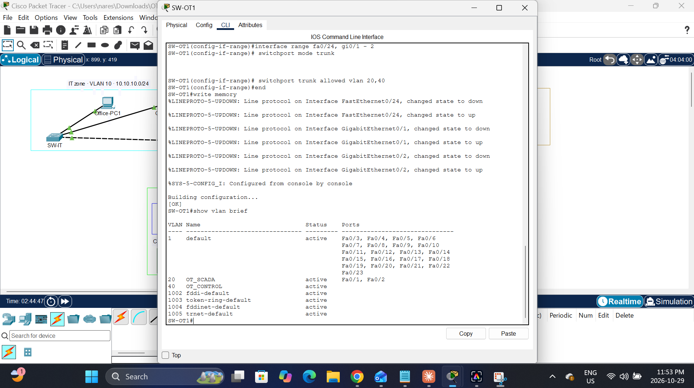

4. **Linked the switches with trunks carrying only the VLANs they need**

   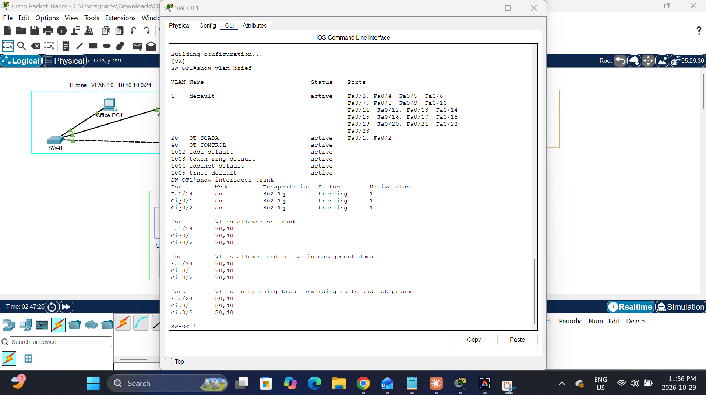

5. **Turned on routing between zones on the core switch**

   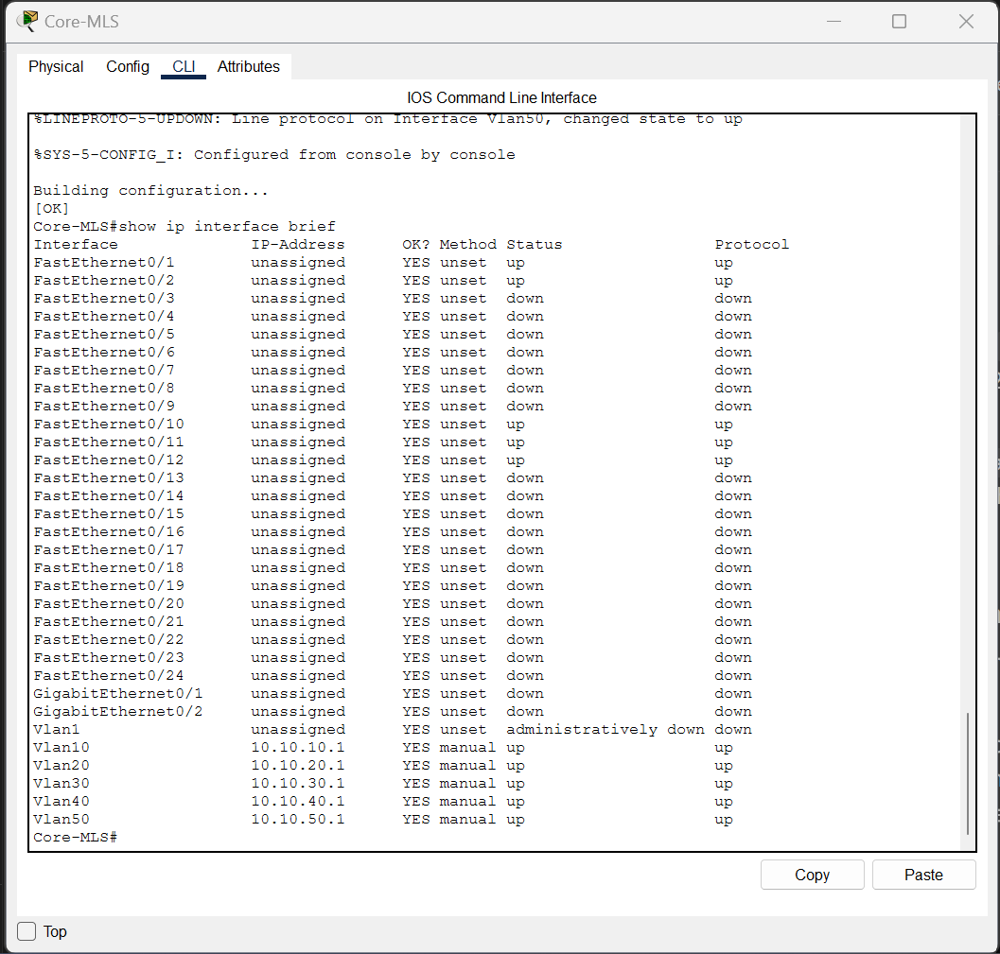

6. **Added the zone rules (ACLs) and mirrored the legacy port to the monitor.** The before-and-after screenshots above show the result.

</details>

<details>
<summary>Click to see the core switch security configuration</summary>

```
ip access-list extended IT_IN
 permit tcp 10.10.10.0 0.0.0.255 host 10.10.30.10 eq 80
 permit tcp 10.10.10.0 0.0.0.255 host 10.10.30.10 eq 443
 deny ip 10.10.10.0 0.0.0.255 10.10.20.0 0.0.0.255
 deny ip 10.10.10.0 0.0.0.255 10.10.30.0 0.0.0.255
 deny ip 10.10.10.0 0.0.0.255 10.10.40.0 0.0.0.255
 deny ip 10.10.10.0 0.0.0.255 10.10.50.0 0.0.0.255
 permit ip any any
ip access-list extended SCADA_IN
 permit ip 10.10.20.0 0.0.0.255 10.10.40.0 0.0.0.255
 permit ip 10.10.20.0 0.0.0.255 host 10.10.30.10
 deny ip any any
ip access-list extended CONTROL_IN
 permit ip 10.10.40.0 0.0.0.255 10.10.20.0 0.0.0.255
 permit ip 10.10.40.0 0.0.0.255 10.10.50.0 0.0.0.255
 deny ip any any
ip access-list extended DMZ_IN
 permit tcp host 10.10.30.10 eq 80 10.10.10.0 0.0.0.255 established
 permit tcp host 10.10.30.10 eq 443 10.10.10.0 0.0.0.255 established
 permit tcp host 10.10.30.10 10.10.20.0 0.0.0.255 established
 permit icmp host 10.10.30.10 10.10.20.0 0.0.0.255 echo-reply
 permit tcp host 10.10.30.10 eq 80 10.10.50.0 0.0.0.255 established
 deny ip any any
ip access-list extended LEGACY_IN
 permit ip 10.10.50.0 0.0.0.255 10.10.40.0 0.0.0.255
 permit tcp 10.10.50.0 0.0.0.255 host 10.10.30.10 eq 80
 deny ip any any
!
interface vlan 10
 ip access-group IT_IN in
interface vlan 20
 ip access-group SCADA_IN in
interface vlan 30
 ip access-group DMZ_IN in
interface vlan 40
 ip access-group CONTROL_IN in
interface vlan 50
 ip access-group LEGACY_IN in
!
monitor session 1 source interface fa0/11 both
monitor session 1 destination interface fa0/12
```

</details>

## What I learned

- Segmentation between zones doesn't stop devices inside a zone from talking (PLC-1 can still reach PLC-2), so controls inside each zone matter too.
- ACLs check packets one at a time. A firewall tracks whole connections and logs them, which is why real plants put industrial firewalls between zones.
- Legacy systems that can't be patched need compensating controls: isolation, least-privilege rules and monitoring.
- A wrong subnet mask can hide behind proxy ARP: everything still worked with 255.0.0.0 because the core switch answered for other subnets. I corrected every device to 255.255.255.0.

## Next steps

1. Send sensor data up through a PLC to a data historian (Packet Tracer 9).
2. Replace the switch ACLs with an ISA-3000 industrial firewall.
3. Replace the simple packet monitor with an OT monitoring tool (Packet Tracer 9's Cyber Observers, inspired by Cisco Cyber Vision).
4. Build a real-tools version: OpenPLC and Node-RED behind a pfSense firewall, with Suricata alerting on Modbus writes.

## Files

- `OT-Network-Lab.pkt`: open it in Cisco Packet Tracer
- `screenshots/`: evidence for each step and test

Built by Vrushil Patel · [LinkedIn](https://linkedin.com/in/vrushil-patel-149474255)
